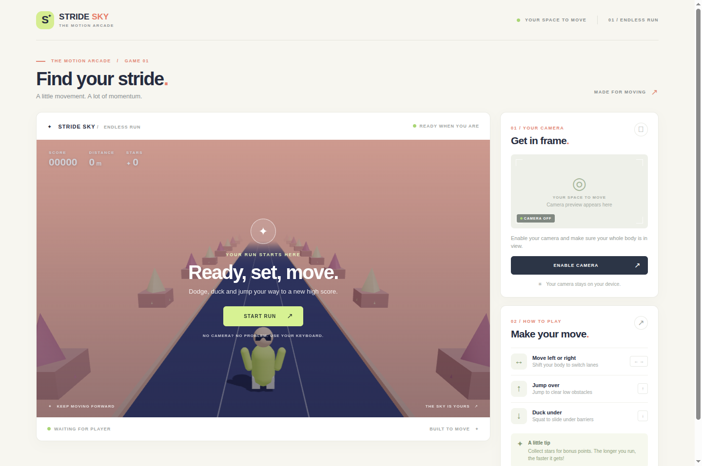
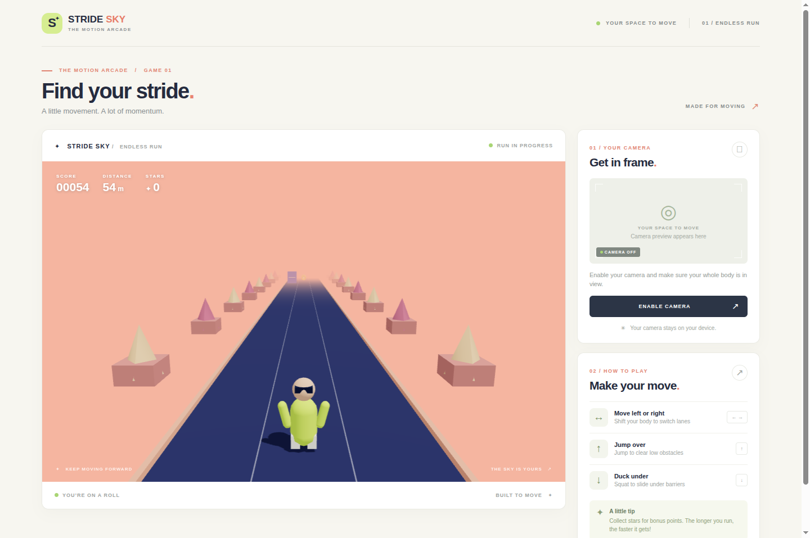

# Stride Sky

An original 3D endless runner controlled with your body or keyboard.

## Screenshots





## Run locally

Requires Node.js 20.19+ or 22.12+.

```sh
npm install
npm run dev
```

MediaPipe (1.2.0), Vite (8.3.5), its React plugin (6.1.2), Oxlint (1.90.0),
and the Zustand dependency used by React Three Fiber (5.0.16) are pinned to
versions available through the Microsoft-protected npm feed. On managed
devices, keep using the approved feed; do not bypass registry restrictions.

Open the displayed local URL in a browser with WebGL support. To use the camera, allow camera access on localhost or HTTPS. Body tracking downloads a MediaPipe pose model from Google on first use, so it requires an internet connection. Video is processed in the browser and is not uploaded.

## How to play

Enable the camera with your head and both shoulders visible, then hold your neutral position still for about a second while tracking calibrates. Half-body framing works seated or standing; your hips and legs do not need to be visible. The camera preview draws lines and joints over visible body landmarks so you can see tracking follow your movements. Recalibrate your neutral position if you change position.

Lean left and right to change lanes. Rise up or raise both hands above your shoulders to jump; return to neutral and visibly lower your hands before jumping again. Lower your shoulders by ducking to slide under overhead obstacles; crouching stays active while you duck and releases when you return upright. Movement thresholds scale to your shoulder width, with smoothing and brief confirmation to reject camera jitter. Tracking automatically recalibrates after a prolonged loss of your shoulders. Full-body movement still works. Avoid the tall blocks. Collect stars for 50 points each; distance also earns points, and the course speeds up as you run.

Small, quick rises also register after a preparatory knee bend, with two elevated
camera samples required to reject isolated tracking spikes. Landing close to your
calibrated height is enough to prepare the next jump; you do not need to return
to exactly the same spot. Slow posture changes are not treated as small jumps.

When both hips are clearly visible, another brief still period automatically
calibrates hip-assisted jumping. Hip rise can confirm a smaller shoulder rise
and reject shoulder-only shrugs; landing rearms the next body jump. Takeoff
triggers the game jump immediately after confirmation, not after landing.
Hips are optional: if either is hidden or low-confidence, shoulder-only controls
remain available while hip tracking waits for a new stable neutral position.
Raising both hands still works without moving your hips.

During camera-controlled runs, tracking alerts explain tracking loss,
calibration, recovery, and menu-pointer suppression even with the sidebar
hidden. Routine jump confirmations and queued-jump messages do not pop up
over the game. The camera menu retains detailed jump feedback and shows
whether hip-assisted or shoulder-only tracking is active.

Alternatively, use the arrow keys or WASD to move, jump, and slide (space also jumps). Click Start Run to play, End Run to return to setup, and Play Again after a run. Give yourself enough clear space to move safely.

### Mystery boxes

Jump into the floating purple **?** boxes to reveal a random reward. A soft
shadow directly beneath each box marks its position on the lane. Walking or
sliding beneath a box does not collect it or cause a collision. A box replaces
the first obstacle wave, then appears roughly every 140–168 meters, separated
from other obstacle waves. Each box's reward is selected once for the shared
course, but every player must collect their own copy. Sword boxes also select
their blue, green, purple, or red blade color once, shared by every collector.

- **Invincibility:** pass through obstacles without losing hearts or points,
  surrounded by colorful sparkles and a gently pulsing, color-cycling glow.
  Reduced-motion preferences replace the animation with a steady golden glow.
- **Laser sword:** make a small, deliberate swing with either arm, or press
  **X** (also **E** in single-player), to break nearby obstacles in your lane.
  Camera swings require two fresh movement samples and are suppressed during
  tracking loss, recalibration, recovery, and menu pointing.
  Each pickup randomly chooses a blue, green, purple, or red blade.
- **Auto blaster:** automatically shoots the nearest obstacle ahead in your
  lane, up to 30 meters away, with a 0.45-second firing interval.
- **Fireballs:** make a small throwing/flicking motion with either hand, or use
  the sword's attack key, to launch a bouncing fireball from that hand. Throws
  have a 0.45-second cooldown. Fireballs stay in their launch lane, break the
  first obstacle they hit, and expire after 40 meters or two seconds.
- **Bonus:** adds one life in Survival, including above the initial five hearts,
  or one 50-point coin in Free Run.

Abilities last **10 seconds**. The power-up name, duration bar, and countdown
follow the runner's chest/back joint, including while jumping, turning, or
sliding, rather than appearing in the score HUD. The final **3 → 2 → 1**
seconds are highlighted before the effect disappears. Multiplayer badges use
compact **INV**, **SWD**, **GUN**, and **FIRE** labels, with full accessible names.
A new ability replaces
the previous one and restarts its timer; life/coin bonuses do not interrupt it.
Weapons never destroy coins or mystery boxes. Effects, rewards, and obstacle
destruction are independent for each player and clear when the run ends.
Flying fireballs also clear on ability replacement or expiry.

Power-ups use original synthesized sounds: a pickup chime, energy-blade hum
and swing, blaster pulses, fireball throws, impact bursts, countdown ticks,
and an expiry cue. Invincibility has its own original shimmering loop. These
are not recordings or themes copied from films or other games. Ability sounds
use the Sound effects volume, respect browser audio unlock and tab visibility,
and stop when their effect or run ends.

### Debug spawning

Open **Game → Debug mode** to control random spawning. Debug mode is **off by
default** and its controls stay inside Game settings, not over the game.

- **Lanes:** allow left, center, right, or any combination.
- **Lane elements:** allow low barriers, overheads, tall blocks, coins, or
  mystery boxes. Choose just one type to force it on every new wave.
- **Mystery-box rewards:** allow invincibility, laser swords, auto blasters,
  fireballs, or the normal mode-specific life/coin bonus.
- **Sword colors:** allow any combination of blue, green, purple, and red.
  Select a single color to force it.

Debug waves randomly select one allowed lane and one allowed element, without
the normal extra coin trail. Boxes independently select an allowed reward and,
for swords, an allowed color. Selecting only mystery boxes produces a box on
every wave instead of waiting for the normal mystery-box spacing. Normal wave
spacing (20–28 meters after the initial 35 meters), pickup rules, collision
rules, and ten-second ability timers remain unchanged.

Changes apply to **new waves only**, including during a run; they do not
rewrite or remove items already on the course. Each group keeps at least one
choice. All players get independent copies of the same selected course items
and box contents. **Reset spawn choices** restores all choices without turning
debug mode off. Turning it off restores normal spawning. Settings persist
across runs in the current page, but reload resets debug mode to off.

### Webcam multiplayer

Up to **four people** can join while the start/setup menu is visible. Enable
the camera, keep each person's shoulders visible with some space between
people, and hold still. Joining takes at least 600ms, followed by independent
neutral calibration. Colored **P1–P4** labels match the camera skeletons,
avatars, and score cards. Select a player above the character arrows to choose
that person's skin. Avatars and their obstacle tracks shrink to fit side by side.

**Start Run locks the roster**: newcomers cannot join an active run. Each
person independently leans, jumps, and slides, with their own stars, score,
mistakes, and five Survival hearts. One player's pickup or fallen obstacle
does not remove a teammate's. Eliminated players stop scoring; the shared run
continues until everyone is out. Free Run keeps all players running.
The first enrolled player controls the two hand-cursor menu pointers.
Crossed-arm neutral resets affect only the person making the gesture;
the sidebar calibration button recalibrates everyone.

Brief tracking loss retains the player's slot and releases their camera slide.
Return to your labeled position to resume. Matching is based on shoulder
position, size, and motion, **not facial recognition**: keep apart and avoid
crossing over each other. Ambiguous overlaps pause controls rather than
guessing identities; someone standing exactly in a missing player's position
cannot reliably be distinguished. More simultaneous poses can increase webcam
inference latency; actual performance depends on the device.
After End Run or everyone finishes, players can join during setup again.
**Reset Players** in the camera sidebar clears enrollment and calibration.

Keyboard controls follow the displayed player order:

| Player | Left / right | Jump | Slide | Slash / throw |
|---|---|---|---|---|
| First | Arrow keys | Up / Space | Down | X |
| Second | A / D | W | S | E |
| Third | J / L | I | K | O |
| Fourth | F / H | T | G | Y |

Single-player retains both arrow keys and WASD. Turning off the camera during
a run leaves enrolled players available for keyboard controls.

### Game modes

Choose a mode in **Game** settings before starting (mode changes are locked during a run):

- **Free Run** (default): mistakes never end the run. Each mistake subtracts
  up to **100 points**, clamped at zero without accumulating score debt.
- **Survival**: start with **five hearts**, lose one per mistake, and end only
  when all five are gone. Hearts are restored when starting a new run.

The runner trips or falls, then gets back up. A 1.6-second recovery grace
prevents a pile-up from charging multiple mistakes; leaning still changes lanes.
Hit obstacles topple, bounce under gravity, move aside, and fade over 1.8 seconds
before removal at three seconds. These are lightweight procedural reactions,
not a full rigid-body/ragdoll simulation. Coin rewards and speed progression
are unchanged. Jumping and ducking resume after recovery.

Jumps still last 0.48 seconds, but rise to the peak in 120ms, hold it for 80ms,
and then descend. Barrier-clearance height is reached in about 50ms instead
of 100ms. The animation skips its initial wind-up and blends in over 35ms;
Hard difficulty uses the actual visible height for barrier clearance. Jump inputs made within
100ms before landing (or slide release) are buffered once, then expire; impacts
and ending a run cancel pending jumps.

### Jump difficulty

The **Jump difficulty** slider in the sidebar's **Game** tab is available
before and during a run, in both Free Run and Survival. Presets are **Easy**
(200ms extra early/late allowance), **Normal** (default, 100ms), and **Hard**
(0ms, the original height-based timing). Drag between presets for 10ms
increments. The readout shows the allowance and total successful timing window.
Mouse, keyboard, and camera-dwell preset / minus / plus buttons are supported.
Your selection is retained when starting another run in the current session.

Lower difficulties accept earlier takeoffs and just-landed jumps, and briefly
defer a barrier penalty so a real late jump can still save it. No jump still
costs the usual points or heart when the allowance expires; crouching is never
guessed to be a jump. Tall blocks, overhead obstacles, speed, scoring, and the
0.48-second jump animation are unchanged. Changing difficulty does not restart
the camera or run.

### Assisted mode

Turn on **Assisted mode** below the difficulty slider in **Game** for optional visual
guidance, before or during a run. A teal arrowed ribbon emphasizes your current
lane; green road zones appear before low jump barriers in their respective
lanes. Jump while the runner is in a green zone. The zone brightens and a
**JUMP NOW** cue appears when you enter it in the correct lane.

Zones use the current speed and difficulty's jump-clearance interval, with a
60ms margin inside each edge rather than recommending last-moment takeoffs.
They grow with more forgiving difficulty, follow curves and bridge elevation,
and disappear after passing or clearing an obstacle. The late-input allowance
can still save a jump after leaving the recommended zone.
Overhead obstacles and tall blocks are never marked as jumpable.
This option does not jump automatically, change scoring, or alter collision
rules. It works with camera, keyboard, Free Run, and Survival, and stays selected
for subsequent runs in the current session.

A vertical speedometer on the far left shows current forward speed in m/s,
with the same 15 minimum and 31 maximum used by the game simulation.

## Characters

Choose a runner using the **left/right arrows beside the character on the lane**
before starting or between runs:
red-shirt skater, dark-outfit skater, white-outfit agent, or cyborg.
Selection works with a mouse, keyboard, or the camera hand cursor, and remains
selected when you play again. Start is disabled while character assets load.

The compact setup menu sits above the runner, keeping Start Run in the upper
half of the screen where hand pointing is easier. Its mode shortcut opens
**Game** settings rather than repeating mode descriptions over the game.
Translucent idle silhouettes stand on both sides of a solo runner, each with a
**+ Join** button that opens the camera controls. These are invitations, not
enrolled players: they disappear when another real player joins or a run starts.
There is one game canvas, and the actual on-lane runner faces you.
With the camera enabled, visible shoulders, elbows,
wrists, and facial landmarks drive arm waves, body lean, and head turns.
Visible legs also follow your pose before a run; legs are never required.
Crouching bends the hips, knees, and ankles instead of shrinking the character.
Before a run, crouches mirror your bent-knee stance. During play, crouching
instead triggers a low feet-first slide: one leg extended, the other tucked,
torso leaning back, and arms bracing beside the body. The pose stays active
while you crouch and returns to running when you stand upright. Down/S uses
the same slide pose for the existing 0.8-second keyboard action.
This is a procedural skeletal pose using the existing character rig, not a
downloaded slide animation. Jump timing, speed, and overhead clearance rules
are unchanged; sliding remains separate from fall/stumble recovery.
During runs, upper-body posing follows the camera while the running/jumping
animations and keyboard controls remain active. This is pose-based motion,
not detailed finger or facial-expression tracking. Missing or stale landmarks
smoothly return to the normal animation.

The runner uses Kenney's Animated Characters Protagonists model and its idle,
run, and jump animations. The imported model,
animations, and four skins are bundled locally under
`public/assets/kenney/characters`, with the original
[CC0 license](public/assets/kenney/characters/License.txt).

## Environment and sound

The route moves through forests, a lantern village, a park, a timber bridge,
an extended lakeshore, and woodland camps. Region lengths, ordering, and prop
variants change between laps. The village uses Kenney Fantasy Town Kit houses,
market stalls, lanterns, fountains, and turning windmill blades; Mini Forest
adds 3D trees, rocks, tents, shelters, fencing, and a park footbridge.
Gentle road bends and bridge approaches are followed automatically by the camera,
runner, and obstacles. Left/centre/right controls and collision timing stay
unchanged: you do not need to steer around the curves.

Park ponds and the lake contain original low-poly swimming ducks and swans,
with rippling water and gentle bobbing. Each lake section is at least 720 metres
long (over 23 seconds even at maximum speed), so it stays beside you instead
of flashing past. Ground animals stay out of the water.

Kenney's Background Elements Remastered trees remain as distant forest
billboards; clouds drift, branches sway, and fireflies float beside the road.
Open **Scenery** in the sidebar to choose
**Evening** or **Daylight**, before or during a run. Daylight
adds a sun, bright sky, warm lighting, and green ground; evening keeps the moon
and fireflies. Changing the light does not restart tracking or reset your run.

Original low-poly frogs, mice, rabbits, and deer cross the lanes with hopping
or running leg motion. Birds circle overhead with flapping wings. Wildlife
animates before the run as well as during play, and ground animals scroll with
the forest. They are decorative, not obstacles: no collisions, score penalties,
or heart losses. No additional downloads or animal asset packs are required.
Menus and the control sidebar remain dark in both modes.

Open **Audio** in the sidebar to adjust **Background music volume** and
**Sound effects volume** independently. Set either to 0 to mute that channel.
Sliders support mouse and keyboard; the −/+ buttons also work with the hand
cursor. **Test Effect** previews the current effects level.

Sound unlocks after a real mouse click or keypress, including enabling the
camera. Camera-generated clicks cannot unlock browser autoplay. An original
eight-second synthesized ambient arcade music loop plays after sound unlocks;
the provided pack contains effects, not music. Kenney effects accompany
footsteps, jumping, crouching, collecting stars, and collisions. Audio is
silenced while the browser tab is hidden. Loading or playback failures are
shown with a retry option, rather than silently ignored.

Artwork and effects are bundled locally with their original CC0 licenses:
[environment](public/assets/kenney/environment/License.txt) and
[sounds](public/assets/kenney/sounds/License.txt), plus the supplied
[Fantasy Town Kit](public/assets/kenney/town/License.txt) and
[Mini Forest](public/assets/kenney/mini-forest/License.txt).
Their palette textures are bundled locally too; no Sketchfab downloads are used.

## Camera responsiveness

Camera controls run MediaPipe locally in a dedicated Web Worker, rather than
blocking Three.js rendering with synchronous inference on the main thread.
Capture and detection are capped at 30fps. Only one frame can be captured or
processed at a time: frames arriving while detection is busy are skipped,
not queued. Each result retains its capture timestamp for gesture timing.
Up to four players are still detected together, without sending camera frames
to a server. Background tracking requires Web Workers, ImageBitmap, and
OffscreenCanvas; unsupported browsers show the existing camera error and can
still use keyboard controls.

The preview skeleton is limited to 15fps and stops updating when Camera & Guide
is hidden. Identical player statuses do not trigger extra React updates.
Movement and gestures still process every completed detection independently
of the preview, and Tracking FPS counts completed worker results, not camera
frames or requested detections. Game FPS is independent of Tracking FPS;
actual performance still depends on CPU/GPU load and the device.
Short smoothing and two-sample gesture confirmation reduce input delay while
rejecting isolated tracking spikes; lane transitions are also quicker.
At 30-60fps, synthetic movement tests confirm deliberate jumps and crouches
within two frames (about 33-67ms). Actual webcam response also depends on
capture and pose-inference time.

For body jumps, sustained upward movement can now trigger before the original
0.18-shoulder-width height threshold. It requires two consecutive fresh upward
intervals, at least 0.06 shoulder widths of rise, and sufficient upward velocity
over a short 70ms prediction horizon. Synthetic rising trajectories trigger in
50-67ms rather than 150-167ms with the old height-only confirmation. This is
measured after movement samples arrive, not total webcam-to-display latency.
Noise spikes, stale frames, slow drift, and ordinary crouch recovery are not
used as early jump signals. A genuine jump after a preparatory crouch still
works through the full-height path; raised hands remain an alternative.

This follows [Celeste's developer explanation of forgiveness](https://www.maddymakesgames.com/articles/celeste_and_forgiveness/index.html):
responsive controls widen valid timing windows and buffer input. We do not
guess that a crouch means a jump merely because a barrier is approaching.
MediaPipe supplies [observed pose landmarks](https://developers.google.com/edge/mediapipe/solutions/vision/pose_landmarker?tab=Web),
not an intention classifier; capture and background inference still contribute
latency, so real-camera testing remains important.

Use `npm run build` for a production build and `npm run lint` to check the code.
Run the regression suite with `node --test tests/*.test.ts`.

The game fills the entire browser window by default. The camera and movement
guide float in a scrollable sidebar in the upper-right corner, open to
**Camera & Guide** by default. Camera activation remains manual.
Use **Hide
Controls** or **Show Controls** to toggle it without stopping camera tracking.
Text is sized for playing away from the screen: scores and jump cues are larger,
and controls and instructions scale up with the viewport. The sidebar and setup
dock remain scrollable on smaller screens.
Menu tabs wrap into rows to stay fully visible with larger text, without
horizontal scrolling.
The **Game**, **Camera & Guide**, **Audio**, **Scenery**, and **FPS** views share the sidebar.
**FPS** shows game-rendering and completed pose-tracking frame rates, updated
once per second using actual elapsed time. Stalled streams report zero; tracking
shows **Camera off** or **Unavailable** when appropriate. These readouts appear
only in the FPS view and do not activate the camera.
Jump difficulty and Assisted mode appear only in **Game**, not above the other
views. Game mode selection also lives there. The movement guide expands with
**How to play**, keeping detailed instructions out of the default view.
Tracking continues when switching views. Recalibration is a filled crosshair-icon
button below the camera controls.
Use **Fullscreen** to hide browser chrome; use **Exit Fullscreen** or Escape to
leave it. Browser fullscreen requires a mouse click or keyboard activation,
not a camera gesture.

## Hands-free buttons

Enable the camera once with a normal click and allow camera access. Both hands
get independent cursors: **green L** for your left hand and **blue R** for your
right hand. The central
camera area maps to the whole screen, mirrored like the preview, so corners are
reachable without moving your hand out of frame.

Hold still over a highlighted button for **0.6 seconds** to click it. The cursor
ring shows progress. Move away before clicking that button again. Two hands on
the same button trigger it only once until both visibly leave it. Start Run,
Play Again, character selection, the sidebar toggle, camera-off, recalibration, and Exit Fullscreen
when already fullscreen support this.
Pointing at a button temporarily suppresses webcam movement commands to avoid
gesture conflicts; keyboard controls remain available. Losing hand tracking
cancels a pending click. Both cursors work with the sidebar hidden.

Cross your forearms across your chest and hold your shoulders still for
**one second** to capture that position as neutral immediately. Shoulders,
elbows, and wrists must be visible; legs are not required. Progress and
confirmation appear even with the sidebar hidden. Button clicks, jumping,
ducking, and lane gestures are suppressed while the cross is held.
Uncross before recalibrating again. Camera gaps or shoulder movement restart
the pending hold, and losing/reacquiring crossed arms cannot repeatedly reset
neutral. This does not restart the camera or tracking model.

Run `node --test tests/bodyTracking.test.ts tests/handPointer.test.ts tests/presentation.test.ts tests/runnerMotion.test.ts tests/gameModes.test.ts`
on Node.js 22.18+ to check controls, hand-pointer logic, scenery wrapping,
wildlife motion, audio configuration, jump timing/clearance, avatar posing, game modes,
collision recovery, falling obstacles, dual-hand dwell, and crossed-arm calibration.
